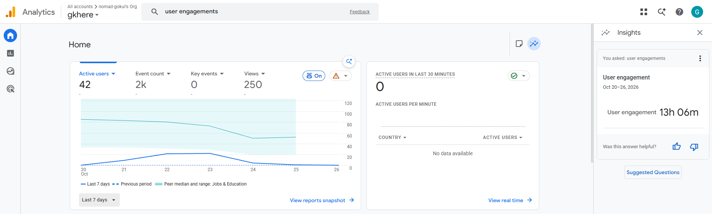

# PSOSM MCQ Guide

A free learn-and-exam practice app for NPTEL's **Privacy & Security in Online Social Media** (noc26-cs141). It puts every question from the course's weekly tutorial sessions — 712 MCQs across 10 weeks plus extra practice sets — in one place, with all options, answers and explanations, plus a timed exam mode.

I built it once, hosted it as a static site, and shared it with a group of about 10 friends taking the course. They kept coming back to it all through exam week. This README is the proof of work: what it does, how it was used, and how much repeated effort it saved.

---

## Real usage (Google Analytics 4, Oct 20 – 26, 2026)



| Metric (exam week, 7 days) | Value |
| --- | --- |
| Real users | **~10 friends** (shared directly, no ads) |
| Total user engagement time | **13 h 06 min 11 s** |
| Engagement per person | **~78 min** on average |
| Page views | **250** (~25 per person) |
| Events (answers, mode switches, navigation) | **~2,000** (~200 per person) |
| GA4 "active users" | 42 (see note below) |

**Why GA shows 42 when about 10 people used it:** GA4 counts each browser and device as a separate user. So one person on a phone and a laptop counts as two, and so does a cleared cookie or an incognito window. The 42 reflects the same ~10 people returning on different devices and sessions through the week.

That repeat usage is the point. About 25 page views and roughly 200 interactions per person means they weren't just opening it once. They came back to it as their main practice tool. Usage peaked on Oct 22–23, right before the exam, and dropped off after it.

> "User engagement" in GA4 only counts time while the tab is in the foreground, so 13 h 06 min is time spent actively on the page, not idle open tabs.

---

## Why one shared tool instead of everyone doing it alone

The course's questions were scattered across 12+ weekly tutorial slide decks, with answers marked by hand during sessions and a few keys that conflicted with each other. Without this site, every student who wanted a proper practice set had to do the same work themselves: download each deck, pull out the questions, figure out the right answers, and — increasingly — paste PDFs into an AI chatbot to do it for them.

I did that work **once**, carefully, and made the result available to everyone.

### Effort and compute saved (estimate)

These are rough numbers built on stated assumptions, not measurements:

| | Each student on their own | With the shared site |
| --- | --- | --- |
| Collecting questions from 12+ decks | ~2–3 h per student | 0 |
| AI extraction / chat sessions over the PDFs | 1 set of long-context sessions **per student** | **1 set, total** (done by me, verified once) |
| Checking answers and resolving conflicting keys | Each person, separately, with inconsistent results | Done once; disputed questions moved to a separate list instead of guessed |
| Cost to serve a visit | — | ₹0 (static files on a CDN, no AI inference per visit) |

- **Duplicate AI compute avoided:** the heavy, long-context extraction over the slide decks ran once instead of about 10 times. Every visit after that is just static files, with no model calls and no server.
- **Student time redirected:** at a conservative ~2 h of collection-and-checking per person, 10 people is roughly **20 hours** not spent on prep work. Instead, they spent **13 h** practicing on the site, as measured.
- **One answer key for everyone:** instead of 10 slightly different self-made sets, some possibly wrong, everyone practiced on the same reviewed bank. The uncertain questions were flagged rather than silently guessed.

---

## Features

- **Learn mode.** Each week opens with its key facts, then every question with all options, the correct one marked, and the reason. You can hide answers and pick before you reveal.
- **Exam mode.** One question at a time with a progress grid, single- and multi-select questions, keyboard shortcuts (A–D, ← →), and shuffled questions and options. At the end you get a score and a full review of each answer.
- **Instant feedback.** As you answer, each question is marked **Correct** or **Wrong** straight away, with the right option highlighted and the reason shown. A live tally shows how many you have right and wrong. Multi-answer questions get a **Check answer** button. The answer locks once marked, and you can switch this off for a classic end-of-test result.
- **Mistakes.** Every question you answer wrong is saved and marked "Missed". You can study or sit just your mistakes, and a question leaves the list once you answer it correctly.
- **Starred questions.** Star any question while learning or during an exam, then practise only the starred ones.
- **Custom exam.** Tick any combination of weeks, choose 10, 20, 30, 50 or all questions, and get one shuffled exam across them.
- **Figures in questions.** Paper tables, CDF plots, adjacency matrices and network graphs are attached where a question needs them.
- **View original PDF.** Every set opens with a button to the Google Drive PDF its questions were taken from. The links live in one file, `content/sources.json`.
- **Unanswered questions.** Questions the source slides don't settle (conflicting keys, no key, missing text) are kept out of every exam. They are listed by week, each with the question cropped from the original PDF, that week's PDF link and a note on what makes it uncertain.
- **Progress stays in your browser.** Best scores, mistakes and stars are kept in `localStorage`. There is no account and no server.
- **Works on any screen.** The layout is responsive and has light and dark themes.

## Tech

- Vanilla JavaScript (ES modules) bundled with [Vite](https://vitejs.dev/). There is no framework and no runtime dependencies.
- The question bank is written in a small plain-text format (`content/sets/*.txt`). `scripts/build-data.mjs` compiles it to JSON at build time.
- That build script also validates every question and fails the build on any of these problems:
  - a missing option
  - an answer key that points at an option that doesn't exist
  - a missing explanation
  - an unknown figure
  - duplicate question text
- It gives each question a stable ID (a hash of its text), so saved mistakes and stars survive edits.
- Fully static output (HTML, JS, CSS, images) with no server code or API calls, so it runs on Cloudflare Pages' free plan. Cache rules are in `public/_headers`.

```
content/
  sets/01-w01.txt …        question sets, one file per week or extra set
  sources.json             set id → Google Drive link(s) of the original PDF
  unanswered.json          unsettled questions, by week, with their screenshots
public/
  figures/                 tables, charts and diagrams attached to questions
  slides/                  question screenshots for the unanswered section
  _headers                 Cloudflare Pages cache rules
scripts/build-data.mjs     compiles and validates the question bank
src/
  main.js                  routing, sidebar, set switching
  store.js                 best scores, mistakes, stars (localStorage)
  views/learn.js           Learn mode
  views/exam.js            Exam mode and results
  views/custom.js          multi-week exam builder
  views/unanswered.js      unanswered questions by week
  views/common.js          question card, options, figures, star button
```

## Question format

```
@ w10 | Week 10 | Session of 3 October — home-location inference, VPN / HTTPS
N: A key fact shown at the top of the week in Learn mode.

Q: According to Table I, which attribute has the highest share of non-geographic information?
I: w10-table1.webp | Table I — availability of geographic information per attribute (%)
A: Employment (Google+) at 50.81%
B: Places Lived (Google+) at 31.48%
C: Venue City (Foursquare) at 26.51%
D: Education (Google+) at 36.04%
=: A
?: One- or two-sentence explanation.
!: Optional note, e.g. where the key came from.
```

The format works like this:

- Questions are separated by a blank line.
- `=:` takes one letter, or several separated by commas (such as `A,C`) for multi-select questions.
- `I:` attaches an image from `public/figures/`. You can attach more than one.

## Run locally

```bash
npm install
npm run dev       # http://localhost:5173
npm run build     # outputs dist/
npm run preview   # serve the production build
```

## Deploy to Cloudflare Pages

**Drag and drop (no Git needed)**
1. Run `npm install && npm run build`, or use the prebuilt `dist` zip.
2. In the Cloudflare dashboard go to **Workers & Pages → Create → Pages → Upload assets**.
3. Name the project, drop in the contents of `dist/` (or the zip), and click **Deploy site**.

**From GitHub (deploys on every push)**
1. Push this folder to a GitHub repository.
2. In **Workers & Pages → Create → Pages → Connect to Git**, pick the repository.
3. Set framework preset **Vite** (or *None*), build command `npm run build`, output directory `dist`. Under environment variables add `NODE_VERSION = 20`. Then **Save and Deploy**.

The site is fully static: no Functions, no server and no API calls, so it stays on the free plan. `public/_headers` is copied into `dist/` and sets long caching for `/assets/*`, a week for figures and screenshots, and revalidation for everything else.

## Traffic analytics

**Users and time spent: Google Analytics 4 (optional, off by default).**

1. Create a free GA4 property at analytics.google.com. Add a **Web** data stream for the site URL and copy its measurement ID (`G-…`).
2. Paste the ID into `analytics.json`. This is `public/analytics.json` in the source, or `analytics.json` at the root of the built `dist` folder, so you can edit it without rebuilding. Then deploy.
3. GA4 then reports **active users, new users, average engagement time per active user, sessions, countries and devices**.
4. The app also sends these events:
   - `page_view`: one per question set opened
   - `exam_start`: an exam begins
   - `question_answered`: includes whether the answer was correct
   - `exam_finish`: includes the score

With an empty ID, nothing is loaded and no data leaves the browser.

**Visits and page views: Cloudflare Web Analytics (free, no cookies).** In the Cloudflare project, open **Metrics → Web Analytics → Enable**, then redeploy once.

## Sources and accuracy

The questions come from the TA-led weekly tutorial sessions of the NPTEL course. Answers follow the keys printed on the slides and the TA's in-class pen marks. Where a slide printed no key, the answer is a plain fact from the course material, and the question says so. Anything still in doubt goes to **Unanswered questions** rather than into an exam.

This is an unofficial study aid and is not affiliated with NPTEL or IIT.
